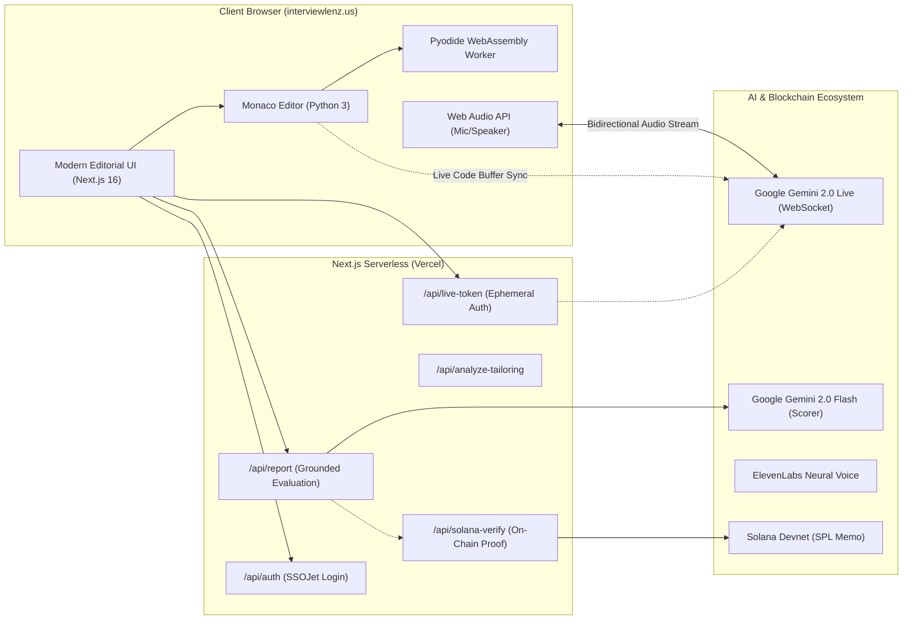

# Interviewlenz

> **The mock interview that actually *listens.***  
> A real-time, bidirectional AI technical and behavioral interviewer that evaluates your Python code and spoken reasoning concurrently.

<div align="center">

[](https://interviewlenz.us)
[](https://youtu.be/SxCWmpXQZL0)
[](https://github.com/Ismail-Abu/interviewlenz)
[](https://ai.google.dev/)
[](https://explorer.solana.com/?cluster=devnet)
[](https://nextjs.org/)

**Built for Hack the Nest 2026 at Eastern Michigan University**  
**Team:** Ismail Abu-shanab & Hamza

</div>

---

## 🎬 Video Walkthrough & Live Demo

Watch our full product walkthrough, live voice interview session, and technical architecture demonstration:

<div align="center">
  <a href="https://youtu.be/SxCWmpXQZL0" target="_blank">
    
  </a>
  <br/>
  <a href="https://youtu.be/SxCWmpXQZL0" target="_blank">
    
  </a>
  &nbsp;&nbsp;
  <a href="https://interviewlenz.us" target="_blank">
    
  </a>
</div>

---

## 💡 The Problem & The Insight

Most coding interview prep tools grade your code like a silent autograder: you type into a box, hit submit, and read a pass/fail message. 

In actual industry interviews at Google, Stripe, or Amazon, writing code is only 50% of the evaluation. **Interviewers grade how you think out loud.** They want to hear your tradeoffs, your edge-case analysis, and how you respond when challenged.

**Interviewlenz bridges this gap.** It pairs an in-browser Python IDE with **Google Gemini 2.0 Multimodal Live API**, creating an AI interviewer that hears you talk in real time, inspects your code as you write it, watches unit test executions, and asks grounded follow-up questions to challenge your assumptions.

---

## 🌐 Hackathon Ecosystem & Technologies

During **Hack the Nest 2026**, our team built Interviewlenz using a coordinated ecosystem centered around **Google Gemini**:

* **Google Gemini 2.0 Live & Flash:** The standout core intelligence of our platform. It powers the real-time bidirectional voice interview engine over WebSockets, keeps live code understanding synchronized as you type, and generates grounded post-interview scorecards. Gemini also served as our primary intelligence coordinating workflow, problem decomposition, and version control.
* **Solana Devnet:** Solves credential inflation with immutable **Proof-of-Skill on-chain attestations**. Every candidate who achieves a Solid or Strong scorecard receives a cryptographically signed SPL Memo transaction on Solana Devnet, linking an unforgeable proof-of-work hash directly to Solana Explorer.
* **Lovable.dev & GitHub:** Lovable enabled rapid scaffolding of our initial editorial UI design system. We brought the codebase into GitHub with an automated suite of 19 deterministic CI tests to ensure rock-solid stability and zero regressions.
* **ElevenLabs:** Powers neural text-to-speech fallback and audio debriefs, giving candidates lifelike spoken commentary on demand.
* **SSOJet:** Enterprise-grade single sign-on authentication, supporting secure OIDC hosted login with NextAuth.
* **Pyodide WebAssembly:** Executes Python 3 code entirely inside a client-side WebAssembly Web Worker, delivering instant test runs without backend queuing or infrastructure cost.
* **Base44 & Google Docs:** Provided early architectural design blueprints and rapid collaborative problem breakdown.

---

## ✨ Core Features

### 🎙️ Real-Time Gemini Live Voice Engine
- Bidirectional low-latency audio stream over WebSockets.
- Listens as you talk through your approach, detecting natural conversational pauses (<850ms).
- Delivers realistic spoken follow-ups (e.g. *"You chose a hash set to pass all tests. What is the space complexity of this approach?"*).
- **Live Code Sync:** As you write or modify code in the editor, the interviewer is continuously updated in real time, acknowledging data structures and logic as you explain them.

### 💻 Client-Side Python IDE (Monaco + Pyodide)
- Full light-theme Monaco Editor with Python syntax highlighting, automatic indentation, and error line markers.
- **Client-Side Pyodide Execution:** Python code runs directly inside a browser WebAssembly worker—instant test execution without backend queuing, cold starts, or runner subscription costs.
- **Unrun Draft Preservation:** Distinguishes tested code versions from unrun drafts in the editor so incomplete edits are never falsely marked as failing test runs.
- **Accessible & Tactile:** Keyboard navigation trap exits (`Ctrl+Shift+M`), responsive mobile layouts, and custom emerald green Run Code control.

### ⛓️ Solana On-Chain Proof-of-Skill Attestations
- When a candidate finishes an interview rated **Solid** or **Strong**, Interviewlenz mints a cryptographic attestation to **Solana Devnet**.
- Emits a signed SPL Memo transaction containing a SHA-256 digest of `[attemptId, band, timestamp]`.
- Candidates receive an immutable verifiable receipt with direct links to **Solana Explorer**.

### 📊 Grounded Telemetry Scorecard & Debrief
- Synthesizes session telemetry (transcripts, code snapshots, test runs) into an actionable post-interview debrief.
- **Verifiable Evidence Receipts:** Cites exact line numbers from your code and exact spoken quotes from the transcript to back up every rating.
- **Three-Step Illuminated Rating Meters:** Evaluates Algorithm Correctness, Space & Time Complexity, and Spoken Communication.
- Downloadable evaluation summary for offline review.

### 🔁 Full Mock Interview Loop
- Multi-round end-to-end interview simulation:
  1. **Round 1:** Technical Coding Challenge with live voice discussion.
  2. **Transition Screen:** Instant round debrief with seamless transition into Behavioral.
  3. **Round 2:** Behavioral Interview tailored to your target company and role.
  4. **Final Summary:** Combined dual-round scorecard with actionable growth recommendations.

### 📱 Mobile-First Responsive Experience
- Touch-scroll passthrough (`touch-action: pan-y !important;`) on Monaco Editor eliminating mobile freeze and tweaking.
- Sticky top navigation bar (`[ 📝 Problem ]` and `[ 💻 Code & Run ↓ ]`) for instant one-tap viewport jumping during live demos.
- Sticky emerald green Run button pinned to the bottom of mobile screens for effortless testing.

---

## 🛠️ Architecture & Tech Stack



| Layer | Technology |
|---|---|
| **Framework** | [Next.js 16.4.6](https://nextjs.org/) (App Router, Turbopack, React 19) |
| **Language & Styling** | TypeScript, [Tailwind CSS](https://tailwindcss.com/), Lucide Icons, Instrument Serif |
| **Code Editor** | [@monaco-editor/react](https://github.com/suren-atoyan/monaco-react) |
| **Python Sandbox** | [Pyodide](https://pyodide.org/) (WebAssembly Python in Web Worker) |
| **Live Voice AI** | [Google Gemini 2.0 Multimodal Live API](https://ai.google.dev/) via WebSockets |
| **Evaluation AI** | Google Gemini 2.0 Flash with JSON schema grounding |
| **Blockchain** | [Solana Devnet](https://solana.com/) (SPL Memo Program) |
| **Voice Synthesis** | [ElevenLabs](https://elevenlabs.io/) Neural Voice API |
| **Authentication** | [SSOJet](https://ssojet.com/) Enterprise Hosted Login & NextAuth |
| **Testing & CI** | Playwright (Headless Browser), 19 Deterministic CI Test Suites |
| **Hosting & Deploy** | [Vercel](https://vercel.com/) with production domain [interviewlenz.us](https://interviewlenz.us) |

---

## 🧪 Deterministic Verification Suite

Every critical user journey and failure mode is continuously verified through **19 automated deterministic test suites** without requiring live API credits or network access:

```sh
npm run test:ci
```

| Test Suite | Purpose | Status |
|---|---|:---:|
| `runner-check.mjs` | Pyodide syntax errors, execution timeouts, stdout capture | ✅ PASS |
| `problem-bank-check.mjs` | Multi-problem bank integrity and solvable test assertions | ✅ PASS |
| `report-check.mjs` | Grounded report telemetry, anti-hallucination guardrails | ✅ PASS |
| `unrun-draft-check.mjs` | Accurate attribution of unrun editor drafts vs tested runs | ✅ PASS |
| `score-check.mjs` | Metric calculation, rating bands, dimension bounds | ✅ PASS |
| `sponsor-check.mjs` | ElevenLabs TTS fallback, Solana Devnet memo signing & digest | ✅ PASS |
| `behavioral-check.mjs` | Question flow, STAR-method rubrics, turn counting | ✅ PASS |
| `tailoring-check.mjs` | Resume and job listing normalization | ✅ PASS |
| `role-context-check.mjs` | Role presets and interview calibration | ✅ PASS |
| `live-freshness-check.mjs` | Ephemeral live session token lifecycles | ✅ PASS |
| `live-grounding-check.mjs` | Question grounding against latest code edits | ✅ PASS |
| `live-queue-check.mjs` | Event queuing during candidate speech | ✅ PASS |
| `live-stages-check.mjs` | Single-turn gating, preventing question stacking | ✅ PASS |
| `live-transcript-check.mjs`| Sequential transcript turn identification | ✅ PASS |
| `live-turnid-check.mjs` | Unique turn ID tracking across reconnects | ✅ PASS |
| `live-reconnect-check.mjs` | WebSocket reconnection state survival | ✅ PASS |
| `live-disconnect-check.mjs`| Graceful network disconnect and offline alerts | ✅ PASS |
| `live-run-evidence-check.mjs`| Co-transmission of code snapshots with test runs | ✅ PASS |
| `plan-check.mjs` | Fallback interview plan generator | ✅ PASS |

---

## 🚀 Running Locally

### Prerequisites
- Node.js 22 or newer
- npm 10 or newer

### Installation
```sh
# Clone repository
git clone https://github.com/Ismail-Abu/interviewlenz.git
cd interviewlenz

# Install dependencies
npm install

# Start local development server
npm run dev
```

Open [http://localhost:3000](http://localhost:3000) in your browser.

> **Note:** The application includes full mock fallbacks. Even without external API keys, the IDE, test runner, and interview simulations work out of the box in real Python using scripted audio and fixture telemetry.

### Environment Configuration
To enable live Gemini voice, ElevenLabs audio, and Solana Proof-of-Skill attestations, create a `.env.local` file:
```env
# Google Gemini 2.0 Live & Scorer
GEMINI_API_KEY="your-gemini-api-key"
LIVE_MODEL="models/gemini-2.0-flash-exp"
REPORT_MODEL="gemini-2.0-flash"

# ElevenLabs Speech Synthesis
ELEVENLABS_API_KEY="your-elevenlabs-key"

# Solana Devnet Proof-of-Skill
SOLANA_DEVNET_SECRET_KEY="[...json_byte_array...]"

# SSOJet Enterprise Authentication
SSOJET_ISSUER="https://your-authority.ssojet.com"
SSOJET_CLIENT_ID="your-client-id"
SSOJET_CLIENT_SECRET="your-client-secret"
NEXTAUTH_SECRET="random-32-byte-secret"
NEXTAUTH_URL="http://localhost:3000"
```

---

## 👥 The Team

* **Ismail Abu-shanab** — Backend Architecture, Gemini 2.0 Multimodal Live API Integration, Pyodide WebAssembly Runner, Solana Proof-of-Skill, CI/CD Pipeline
* **Hamza** — Frontend Systems, Interaction Design & Editorial Architecture

*Built with passion at **Hack the Nest 2026** at Eastern Michigan University.*
