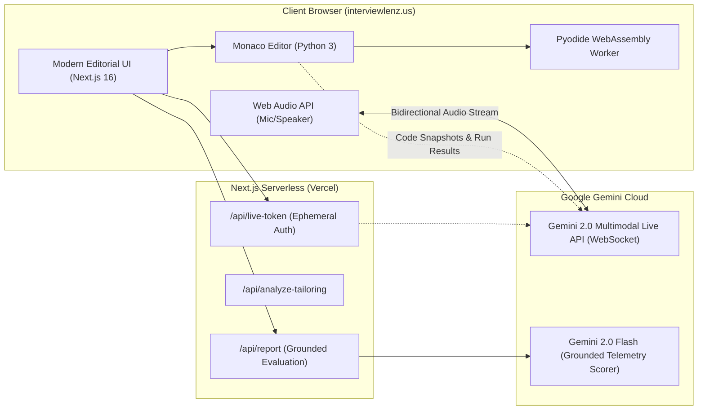

# Interviewlenz

> **The mock interview that actually *listens.***  
> A real-time, bidirectional AI technical and behavioral interviewer that evaluates your code and spoken reasoning concurrently.

[](https://interviewlenz.us)
[](https://github.com/Ismail-Abu/interviewlenz)
[](https://ai.google.dev/)
[](https://nextjs.org/)

**Built for Hack the Nest 2026 at Eastern Michigan University**  
**Team:** Ismail Abu-shanab & Hamza

---

## 🌐 Live Application
Experience the live platform deployed to production on Vercel:  
👉 **[https://interviewlenz.us](https://interviewlenz.us)**

---

## 💡 The Problem & The Insight
Most coding interview prep tools grade your code like a silent autograder: you type into a box, hit submit, and read a pass/fail message. 

In actual industry interviews at Google, Stripe, or Amazon, writing code is only 50% of the evaluation. **Interviewers grade how you think out loud.** They want to hear your tradeoffs, your edge-case analysis, and how you respond when challenged.

**Interviewlenz bridges this gap.** It pairs an in-browser Python IDE with **Google Gemini 2.0 Multimodal Live API**, creating an AI interviewer that hears you talk in real time, inspects your code and unit test executions as you work, and asks grounded, conversational follow-up questions to challenge your assumptions.

---

## ✨ Core Features

### 🎙️ Real-Time Gemini Live Voice Engine
- Bidirectional low-latency audio stream over WebSockets.
- Listens as you talk through your approach, detecting natural conversational pauses (<850ms).
- Delivers realistic spoken follow-ups (e.g. *"You chose a hash set to pass all tests. What is the space complexity of this approach?"*).
- Adapts dynamically if your code contradicts your spoken explanation.

### 💻 Client-Side Python IDE (Monaco + Pyodide)
- Full light-theme Monaco Editor with syntax highlighting, automatic indentation, and error line markers.
- **Client-Side Pyodide Execution:** Python code runs directly inside a browser WebAssembly worker—instant test execution without backend queuing, cold starts, or runner subscription costs.
- **Unrun Draft Preservation:** Distinguishes tested code versions from unrun drafts in the editor so incomplete edits are never falsely marked as failing test runs.
- **Accessible & Tactile:** Keyboard navigation trap exits (`Ctrl+Shift+M`), responsive mobile layouts, and custom emerald green Run Code control.

### 📊 Grounded Telemetry Scorecard & Debrief
- Synthesizes session telemetry (transcripts, code snapshots, test runs) into an actionable post-interview debrief.
- **Verifiable Evidence Receipts:** Cites exact line numbers from your code and exact spoken quotes from the transcript to back up every rating.
- **Three-Step Illuminated Rating Meters:** Evaluates Algorithm Correctness, Space & Time Complexity, and Spoken Communication.
- Downloadable evaluation summary for offline review.

### 🎯 Role & Company Tailoring
- One-click role presets for top tech tiers:
  - **Stripe:** Backend Engineer
  - **Google:** Software Engineer Intern
  - **Amazon:** Distributed Systems
  - **Meta:** Systems Engineer
- Supports custom candidate resume uploads and job description inputs to calibrate interviewer tone and behavioral questions.

---

## 🛠️ Architecture & Tech Stack



| Layer | Technology |
|---|---|
| **Framework** | [Next.js 16.4.6](https://nextjs.org/) (App Router, Turbopack, React 19) |
| **Language & Styling** | TypeScript, [Tailwind CSS](https://tailwindcss.com/), Lucide Icons, Instrument Serif |
| **Code Editor** | [@monaco-editor/react](https://github.com/suren-atoyan/monaco-react) |
| **Python Sandbox** | [Pyodide](https://pyodide.org/) (WebAssembly Python in Web Worker) |
| **Live Voice AI** | [Google Gemini 2.0 Multimodal Live API](https://ai.google.dev/) via WebSockets |
| **Evaluation AI** | Google Gemini 2.0 Flash with JSON schema grounding |
| **Testing & CI** | Playwright (Headless Browser), Custom Deterministic CI Harness |
| **Hosting** | [Vercel](https://vercel.com/) with custom domain [interviewlenz.us](https://interviewlenz.us) |

---

## 🧪 Deterministic Verification Suite

Every critical user journey and failure mode is continuously verified through 17 automated deterministic test suites without requiring live API credits or network access:

```sh
npm run test:ci
```

| Test Suite | Purpose | Status |
|---|---|:---:|
| `runner-check.mjs` | Pyodide syntax errors, execution timeouts, stdout capture | ✅ PASS |
| `report-check.mjs` | Grounded report telemetry, anti-hallucination guardrails | ✅ PASS |
| `unrun-draft-check.mjs` | Accurate attribution of unrun editor drafts vs tested runs | ✅ PASS |
| `score-check.mjs` | Metric calculation, rating bands, dimension bounds | ✅ PASS |
| `behavioral-check.mjs` | Question flow, STAR-method rubrics, turn counting | ✅ PASS |
| `tailoring-check.mjs` | Resume and job listing normalization | ✅ PASS |
| `role-context-check.mjs` | Role presets and interview calibration | ✅ PASS |
| `live-freshness-check.mjs` | Ephemeral live session token lifecycles | ✅ PASS |
| `live-grounding-check.mjs` | Question grounding against latest code edits | ✅ PASS |
| `live-queue-check.mjs` | Event queuing during candidate speech | ✅ PASS |
| `live-reconnect-check.mjs` | WebSocket reconnection state survival | ✅ PASS |
| `live-disconnect-check.mjs` | Graceful network disconnect and offline alerts | ✅ PASS |
| `live-run-evidence-check.mjs`| Co-transmission of code snapshots with test runs | ✅ PASS |
| `plan-check.mjs` | Fallback interview plan generator | ✅ PASS |
| `integration-browser-check` | End-to-end Playwright tests on Desktop & Mobile (390×844) | ✅ PASS |

---

## 🚀 Running Locally

### Prerequisites
- Node.js 22 or newer
- npm 10 or newer

### Installation
```sh
# Clone repository
git clone https://github.com/Ismail-Abu/interviewlenz.git
cd interviewlenz

# Install dependencies
npm install

# Start local development server
npm run dev
```

Open [http://localhost:3000](http://localhost:3000) in your browser.

> **Note:** The application includes full mock fallbacks. Even without a `GEMINI_API_KEY`, the IDE and test runner work completely out of the box in real Python, using scripted audio and fixture telemetry for demonstration.

### Optional: Real Voice & Evaluation with Gemini
To enable real Gemini Live audio and evaluation locally:
1. Create a `.env.local` file:
   ```env
   GEMINI_API_KEY="your-gemini-api-key"
   LIVE_MODEL="models/gemini-2.0-flash-exp"
   REPORT_MODEL="gemini-2.0-flash"
   ```
2. Restart `npm run dev`.

---

## 👥 The Team
- **Ismail Abu-shanab** — Backend Architecture, Gemini Live Multimodal Integration, Pyodide Runner, Telemetry & CI
- **Hamza** — Frontend Systems, Interaction Design & Editorial Architecture

*Built with passion at Hack the Nest 2026.*

### Optional sponsor integrations

Set server environment variables from .env.example and restart the app. Play question (with the interview mic muted) and Audio Debrief send the displayed question or round recommendation to ElevenLabs on demand. Without a key or when the service is unavailable, playback uses the device's speech synthesis when supported.

To issue Proof of Skill receipts, configure SOLANA_DEVNET_SECRET_KEY with a dedicated Devnet keypair's JSON byte array and fund its public address with Devnet SOL. Each real round report rated Solid or Strong submits one signed memo at report generation. Its payload is the prefix `interviewlenz:skill:v1:` followed by the SHA-256 hex digest of the UTF-8 JSON array `[attemptId, band, createdAt]`. The band is lowercase and the timestamp is the report's ISO timestamp. Source, transcripts and names stay off-chain. The scorecard links to Explorer and can verify the confirmed memo and issuer. This attests to an app-generated practice assessment, without identity verification.

### SSOJet sign-in

Create an SSOJet web application with hosted login. Register the exact production redirect URI `https://interviewlenz.us/api/auth/callback/ssojet`. Set `SSOJET_ISSUER` (the project's authority URL), `SSOJET_CLIENT_ID`, `SSOJET_CLIENT_SECRET`, `NEXTAUTH_SECRET` (a random secret), and `NEXTAUTH_URL=https://interviewlenz.us` on the server, then redeploy. Local development uses its own registered localhost callback and origin.

The navigation shows Sign in when the provider is configured and Remember me for browser-local practice otherwise. NextAuth handles discovery, code exchange and the session cookie. Interview history remains on the device.
